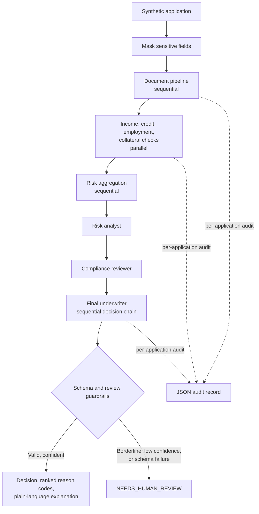

## Intelligent Load Orchestration System (ILOS)

A synthetic-data, interview-ready prototype that demonstrates typed agent
orchestration with Google ADK for intelligent loan processing and orchestration.
It highlights sequential document processing, parallel specialist checks, a
sequential decision chain, schema validation, and human-review routing for a
healthcare/insurance-style risk workflow. It is not a lending product,
credit-risk model, or production system.

## Problem and scope

The loan scenario is a way to explore how independent assessments can be
coordinated and audited. The healthcare example reuses those patterns for a
synthetic prior-authorization request. Both workflows are demonstrations only:
they do not make real financial, clinical, or coverage decisions.

## Architecture



Agent input and output contracts are defined with Pydantic. Invalid structured
output is retried once (two total attempts); if validation still fails, the
workflow returns `NEEDS_HUMAN_REVIEW` instead of inferring a decision. Each
final decision includes ranked reason codes and a plain-language explanation.
The loan workflow masks configured PII patterns before model calls and audit
output; masking is a limited prototype safeguard, not a guarantee of
de-identification.

The [architecture notes](docs/architecture.md) describe the request flow,
reliability boundary, and limitations in more detail.

## Design decisions and tradeoffs

- **Multiple agents instead of one prompt:** separate contracts make
  assessments easier to inspect and test independently. This adds orchestration
  complexity and does not by itself improve decision quality.
- **Parallel specialist checks:** income, credit, employment, and collateral
  assessments share the same input and are modeled as independent tasks.
  Aggregation follows them because it depends on their outputs. No provider
  speedup is claimed or measured here.
- **Sequential review chain:** each reviewer follows and can use the prior
  review. This is a sequential decision chain, not a separate authority-handoff
  protocol or verified compliance process.
- **Stub by default:** local demos, tests, and evaluation run without API
  credentials. The deterministic stub is for exercising code paths, not
  evidence about the quality of an LLM.
- **Session storage:** `src/session_store.py` defines a swappable provider
  interface and an in-memory implementation. It is process-local and not
  durable; Redis/Postgres implementations are future work.

## Reproduce locally

Requires Python 3.11 or later.

```powershell
python -m venv .venv
.venv\Scripts\Activate.ps1
python -m pip install -r requirements.txt -r requirements-dev.txt
```

The default `LLM_MODE=stub` needs no `.env` file or API key.

```powershell
# Loan demo
python main.py

# Synthetic prior-authorization demo
python -m examples.prior_authorization.demo

# Rebuild the 50-case dataset, evaluate it, and run the paired proxy check
python -m evals.generate_dataset
python -m evals.run_eval --mode stub
python -m evals.fairness_check --mode stub

# Lint, type-check, and run tests with the coverage gate
ruff check .
mypy
python -m pytest -q --cov=src --cov=evals --cov=examples `
  --cov-report=term-missing `
  --cov-report=json:evals/results/coverage.json `
  --cov-fail-under=80
```

The last command uses PowerShell line continuation. On a single line, remove
the backticks. `make test` and `make eval` provide corresponding shortcuts where
GNU Make is installed.

The evaluation scripts write their dataset and reports to `evals/data/` and
`evals/results/`. The checked-in reports are generated outputs; rerunning the
commands refreshes them.

To use a live provider, set `LLM_MODE=adk`, set `LLM_MODEL` to a
LiteLLM-supported provider/model identifier, and provide the matching API key
through the environment. Live calls can incur charges; no live-provider
evaluation results are included below.

## Synthetic evaluation snapshot

The checked-in [evaluation summary](evals/results/evaluation_summary.md) and
[JSON results](evals/results/evaluation_results.json) were produced in stub
mode from 50 generated cases, with three runs per case. Expected labels are
synthetic rule-derived targets, not historical outcomes. `NEEDS_HUMAN_REVIEW`
is mapped to `conditional` for the three-class metrics, and the separate review
count is in the JSON report.

| Measure | Recorded result |
|---|---:|
| Decision accuracy | 0.7000 |
| Approve precision / recall / F1 | 1.0000 / 0.8667 / 0.9286 |
| Conditional precision / recall / F1 | 0.5833 / 1.0000 / 0.7368 |
| Reject precision / recall / F1 | 1.0000 / 0.0714 / 0.1333 |
| All three repeated decisions identical | 1.0000 |
| Mean pairwise decision agreement | 1.0000 |
| Document-processing mean latency | 0.000259 s |
| Risk-assessment mean latency | 0.000155 s |
| Approval-workflow mean latency | 0.000171 s |
| Estimated token cost | $0.573867 |

These figures describe this synthetic stub run only. The especially low reject
recall is an important failure, not a claim of acceptable lending performance.
Stub token counts are character-based estimates priced with model-cost
metadata; the estimated cost is not a bill and no provider calls were made.
Stub latencies are local code-path timings, not LLM or production latency.
Evaluation limitations and individual failure cases are recorded in the
generated summary.

The generated [coverage report](evals/results/coverage.json) records **83.22%
coverage** for the configured `src`, `evals`, and `examples` scope. The CI
workflow runs Ruff, mypy, and pytest with an 80% coverage threshold.

The [paired proxy check](evals/results/fairness_summary.md) reports **20
synthetic pairs** and **0.0000 decision disagreement** for the tested name and
ZIP-code perturbations. This small test does not establish fairness or measure
disparate impact, calibration, group error rates, or intersectional effects.
It is especially limited because the stub ignores ZIP codes and names are
masked before model input.

## Responsible use and limitations

- Use only the included synthetic data. The PII masking rules are not a
  substitute for privacy engineering, secure storage, access controls, or
  de-identification review.
- A human-review status is a workflow signal, not an implemented human
  decision process. No reviewer UI or operational escalation service exists.
- Synthetic labels and deterministic stub behavior cannot establish real-world
  accuracy, suitability, fairness, or regulatory compliance.
- The audit files are ordinary JSON artifacts, not tamper-evident or
  access-controlled records.
- The prior-authorization example uses synthetic data only. **No real PHI is
  used; the project is not HIPAA-certified and is not intended for clinical,
  coverage, or treatment decisions.**
- Agent frameworks and APIs evolve. The installed ADK emits deprecation
  warnings for its `SequentialAgent` and `ParallelAgent` patterns; migration
  to the newer workflow APIs remains future work.

## Project layout

```text
config/                       Environment-backed settings
src/                          Loan schemas, agents, orchestration, guardrails
examples/prior_authorization/ Synthetic healthcare workflow and demo
evals/                        Synthetic dataset, evaluation, fairness scripts
evals/results/                Generated evaluation and coverage reports
tests/                        Unit and integration tests
docs/architecture.md          Additional architecture and reliability notes
```

## License

MIT; see [LICENSE](LICENSE).
# Intelligent-Load-Orchestration-System-ILOS-

