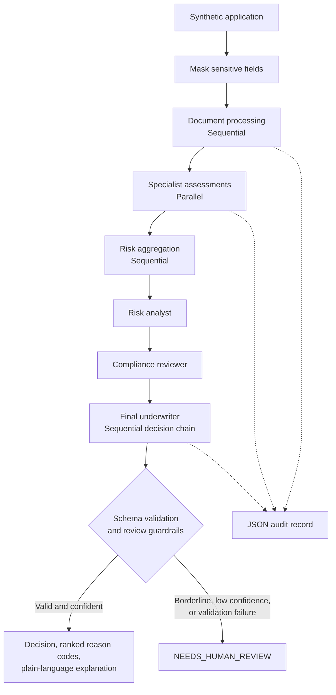

# Intelligent Load Orchestration System (ILOS)

A synthetic-data, interview-ready prototype demonstrating typed agent orchestration with Google ADK for intelligent loan processing and workflow orchestration.

The project showcases sequential document processing, parallel specialist assessments, a sequential decision chain, schema validation, audit logging, and human-review routing for loan-processing and healthcare/insurance-style workflows.

**Disclaimer:** This is a demonstration prototype, not a lending product, credit-risk model, production system, or tool for making real financial, clinical, or insurance-coverage decisions.

## Problem and Scope

The project explores how independent assessments can be coordinated, validated, and audited through a multi-agent workflow.

It includes two synthetic demonstration scenarios:

- **Loan processing:** Coordinates document processing, income and credit assessments, employment and collateral checks, risk aggregation, and decision review.
- **Prior authorization:** Reuses the orchestration patterns for a synthetic healthcare prior-authorization workflow.

Both workflows are demonstrations only. They do not make real financial, clinical, or insurance-coverage decisions.

## Architecture



### Workflow and Validation

Agent input and output contracts are defined using Pydantic.

The workflow retries invalid structured output once, allowing a maximum of two attempts. If validation still fails, it returns `NEEDS_HUMAN_REVIEW` instead of inferring a decision from invalid output.

Each final decision includes ranked reason codes and a plain-language explanation.

The loan workflow masks configured PII patterns before model calls and audit output. This is a limited prototype safeguard, not a guarantee of de-identification.

See [Architecture Notes](docs/architecture.md) for more details about request flow, reliability boundaries, and system limitations.

## Design Decisions and Trade-offs

### 1. Multiple Agents Instead of One Prompt

Separate agents use distinct input and output contracts, making assessments easier to inspect, test, and debug independently.

**Trade-off:** This increases orchestration complexity and does not automatically improve decision quality.

### 2. Parallel Specialist Assessments

Income, credit, employment, and collateral assessments are modeled as independent tasks operating on shared input data. Risk aggregation runs afterward because it depends on their outputs.

**Trade-off:** Parallel execution introduces coordination and failure-handling requirements. No provider-level speedup is claimed or measured in this prototype.

### 3. Sequential Review Chain

The risk analyst, compliance reviewer, and final underwriter operate in sequence. Each stage can use the preceding review's output.

**Trade-off:** This demonstrates sequential decision orchestration, not a separate authority-handoff protocol or a verified compliance process.

### 4. Deterministic Stub by Default

Local demonstrations, tests, and evaluations can run without API credentials. The deterministic stub exercises workflow paths and validation logic.

**Trade-off:** Stub results are not evidence of LLM quality or real-world decision performance.

### 5. Swappable Session Storage

`src/session_store.py` defines a provider interface and an in-memory implementation.

**Trade-off:** Session state is process-local and non-durable. Redis or PostgreSQL-backed session storage remains future work.

## Prerequisites

- Python 3.11 or later
- Git
- A terminal such as PowerShell
- API credentials for a supported model provider, if running in live ADK mode

## Run Locally

### 1. Clone the Repository

```powershell
git clone https://github.com/Sarthak9131/Intelligent-Load-Orchestration-System-ILOS-.git
cd Intelligent-Load-Orchestration-System-ILOS-
```

If the repository is already cloned, open its existing directory instead.

### 2. Create and Activate a Virtual Environment

```powershell
python -m venv .venv
.venv\Scripts\Activate.ps1
```

### 3. Install Dependencies

```powershell
python -m pip install -r requirements.txt -r requirements-dev.txt
```

The default `LLM_MODE=stub` requires neither a `.env` file nor an API key.

### 4. Run the Loan Processing Demo

```powershell
python main.py
```

### 5. Run the Prior-Authorization Demo

```powershell
python -m examples.prior_authorization.demo
```

## Evaluation and Testing

### Rebuild the Synthetic Dataset

```powershell
python -m evals.generate_dataset
```

### Run the Evaluation

```powershell
python -m evals.run_eval --mode stub
```

### Run the Paired Proxy Check

```powershell
python -m evals.fairness_check --mode stub
```

### Run Linting, Type Checking, and Tests

```powershell
ruff check .
mypy
python -m pytest -q --cov=src --cov=evals --cov=examples --cov-report=term-missing --cov-report=json:evals/results/coverage.json --cov-fail-under=80
```

The test command enforces a minimum coverage threshold of 80%.

`make test` and `make eval` provide corresponding shortcuts when GNU Make is installed.

Evaluation scripts write their datasets and reports to `evals/data/` and `evals/results/`. Checked-in reports are generated artifacts and can be refreshed by rerunning the relevant commands.

## Using a Live Model Provider

To use a live model provider:

1. Set `LLM_MODE=adk`.
2. Configure `LLM_MODEL` with a provider/model identifier supported by the project's LiteLLM integration.
3. Supply the corresponding API key through an environment variable or the project's supported environment configuration.
4. Run the desired workflow and verify its output and audit records.

Live model calls may incur charges. No live-provider evaluation results are included in this README.

## Synthetic Evaluation Results

The checked-in [evaluation summary](evals/results/evaluation_summary.md) and [JSON results](evals/results/evaluation_results.json) were generated in stub mode using 50 synthetic cases, with three runs per case.

Expected labels are synthetic, rule-derived targets rather than historical outcomes. For the three-class metrics, `NEEDS_HUMAN_REVIEW` is mapped to `conditional`; the JSON report separately records the review count.

### Recorded Metrics

| Metric | Recorded Result |
|---|---:|
| Decision accuracy | 0.7000 |
| Approve precision / recall / F1 | 1.0000 / 0.8667 / 0.9286 |
| Conditional precision / recall / F1 | 0.5833 / 1.0000 / 0.7368 |
| Reject precision / recall / F1 | 1.0000 / 0.0714 / 0.1333 |
| All three repeated decisions identical | 1.0000 |
| Mean pairwise decision agreement | 1.0000 |
| Document-processing mean latency | 0.000259 s |
| Risk-assessment mean latency | 0.000155 s |
| Approval-workflow mean latency | 0.000171 s |
| Estimated token cost | $0.573867 |

**Important interpretation:** These figures describe this synthetic stub run only.

The especially low reject recall is a significant failure, not evidence of acceptable lending performance. Perfect repeatability reflects deterministic stub behavior and does not establish correctness.

Stub token counts are character-based estimates priced using model-cost metadata. The estimated cost is not an actual bill, and no provider calls were made. Stub latencies are local code-path timings, not LLM inference or production latency.

Individual failure cases and additional evaluation limitations are documented in the generated evaluation summary.

### Code Coverage

The generated [coverage report](evals/results/coverage.json) records **83.22% coverage** for the configured `src`, `evals`, and `examples` scope.

The CI workflow runs Ruff, mypy, and pytest with an 80% coverage threshold.

### Paired Proxy Check

The [fairness summary](evals/results/fairness_summary.md) reports 20 synthetic pairs and 0.0000 decision disagreement for the tested name and ZIP-code perturbations.

This small test does not establish fairness or measure disparate impact, calibration, group error rates, or intersectional effects. Its scope is especially limited because the stub ignores ZIP codes and names are masked before model input.

## Responsible Use and Limitations

- **Synthetic data only:** Use only the included synthetic data. PII masking is not a substitute for privacy engineering, secure storage, access controls, or formal de-identification review.
- **Human review is not implemented:** `NEEDS_HUMAN_REVIEW` is a workflow signal. The prototype does not include a reviewer UI or operational escalation service.
- **No real-world validation:** Synthetic labels and deterministic stub behavior cannot establish real-world accuracy, suitability, fairness, or regulatory compliance.
- **Basic audit artifacts:** Audit files are ordinary JSON records, not tamper-evident or access-controlled audit logs.
- **Healthcare limitations:** The prior-authorization example uses synthetic data only. No real protected health information (PHI) is used. The project is not HIPAA-certified and is not intended for clinical, coverage, or treatment decisions.
- **Framework evolution:** The installed ADK version emits deprecation warnings for its `SequentialAgent` and `ParallelAgent` patterns. Migration to newer workflow APIs remains future work.

## Project Structure

```text
config/                         Environment-backed settings
src/                            Loan schemas, agents, orchestration, guardrails
examples/
  prior_authorization/           Synthetic healthcare workflow and demo
evals/                           Synthetic dataset and evaluation scripts
evals/results/                   Evaluation and coverage reports
tests/                           Unit and integration tests
docs/architecture.md             Architecture and reliability notes
main.py                          Loan-processing demo entry point
requirements.txt                  Runtime dependencies
requirements-dev.txt              Development and testing dependencies
```

## License

This project is licensed under the MIT License. See [LICENSE](LICENSE) for details.
